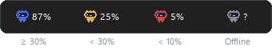
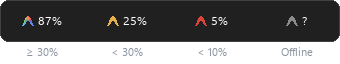

<div align="center">

# Limit Tray for Claude, Codex & Antigravity

**Your remaining Claude Code, OpenAI Codex and Google Antigravity usage limits right on the Windows taskbar — just like the battery percentage.**

<p>
  
  <br />
  <sub>Antigravity, Codex and Claude on the Windows 11 taskbar, right next to the system tray.</sub>
</p>

<table>
  <tr>
    <th>Claude</th>
    <th>Codex</th>
    <th>Antigravity</th>
  </tr>
  <tr>
    <td></td>
    <td></td>
    <td></td>
  </tr>
</table>
<sub>All states at actual taskbar size (rendered directly by the app).</sub>

<p>
  
  
  
</p>

</div>

---

A tiny Windows taskbar widget that shows a pixel-art mascot and how much of your usage limit is **left**, right next to the system tray. No Electron, no background bloat, just plain Python. Run any combination of the Claude, Codex and Antigravity widgets: they line up next to each other automatically.

## Install

You need **Windows 10/11**, **[Python 3.10+](https://www.python.org/downloads/)** and **[Git](https://git-scm.com/download/win)**. Paste one command into **PowerShell**:

### Claude

Requires [Claude Code](https://claude.com/claude-code) installed and signed in (Pro or Max plan).

```powershell
git clone https://github.com/jakmot12/claude-limit-tray.git; cd claude-limit-tray; python -m pip install -r requirements.txt; pythonw claude_limit_tray.py
```

### Codex

Requires [Codex](https://openai.com/codex) (CLI or app) used at least once with a ChatGPT plan.

```powershell
git clone https://github.com/jakmot12/claude-limit-tray.git; cd claude-limit-tray; python -m pip install -r requirements.txt; pythonw codex_limit_tray.py
```

### Antigravity

Requires [Antigravity](https://antigravity.google) (IDE or `agy` CLI) installed and signed in.

```powershell
git clone https://github.com/jakmot12/claude-limit-tray.git; cd claude-limit-tray; python -m pip install -r requirements.txt; pythonw antigravity_limit_tray.py
```

### All three

```powershell
git clone https://github.com/jakmot12/claude-limit-tray.git; cd claude-limit-tray; python -m pip install -r requirements.txt; pythonw claude_limit_tray.py; pythonw codex_limit_tray.py; pythonw antigravity_limit_tray.py
```

> [!TIP]
> To launch it automatically, **right-click the mascot → Start with Windows**. Each widget has its own toggle.

**Update:** `cd claude-limit-tray; git pull`, then restart the widget (right-click → **Quit**, run it again).
**Uninstall:** turn off **Start with Windows**, **Quit**, and delete the folder.

## Features

- **Battery-style taskbar indicator** — crisp pixel-art mascot + remaining percentage in `Segoe UI Variable` (plain `Segoe UI` on Windows 10), sized like the battery icon (tested at 100% display scaling; other scales are approximated).
- **5-hour & weekly limits** — pick which one the taskbar shows in the right-click menu; hover to see **all of them** with exact reset countdowns. Antigravity has separate pools (Gemini, Claude & GPT) and shows the **lowest** by default.
- **At-a-glance color coding** — brand color (`≥ 30%`) → yellow (`< 30%`) → red (`< 10%`); gray with `?` when there is no data.
- **Stays out of your way** — hides during fullscreen games/videos, when an auto-hidden taskbar collapses, or when the taskbar isn't at the bottom of the primary monitor.
- **Single instance** — launching it twice never creates duplicates.

## Controls

| Action | Behavior |
| :--- | :--- |
| **Hover** | Show both 5-hour and weekly remaining limits with reset times |
| **Left-click** | Refresh immediately |
| **Right-click** | Switch limit (**5 hours** / **Week**, or a quota pool for Antigravity), **Refresh now**, toggle **Start with Windows**, or **Quit** |

## How it gets the data

| | Claude | Codex | Antigravity |
| :--- | :--- | :--- | :--- |
| **Source** | Claude Code's usage endpoint (`api.anthropic.com/api/oauth/usage`), polled every 3 minutes | The rate limits Codex writes into its own session logs (`%USERPROFILE%\.codex\sessions`) after every turn | Google's Cloud Code endpoint that Antigravity itself uses (`daily-cloudcode-pa.googleapis.com`), polled every 3 minutes |
| **Network** | HTTPS to `api.anthropic.com` only | None, fully offline | HTTPS to `daily-cloudcode-pa.googleapis.com` only |
| **Credentials** | Reads the Claude Code token from `%USERPROFILE%\.claude\.credentials.json` (read-only, never refreshed or logged) | None, never touches `.codex\auth.json` | Reads the Antigravity token from Windows Credential Manager (`gemini:antigravity`; read-only, never refreshed or logged) |
| **Freshness** | Live | As of your **last Codex use** (shown in the tooltip); after a reset time passes it shows 100% | Live while Antigravity keeps its 1-hour token fresh; otherwise the last saved values (time shown in the tooltip), and 100% once a reset time passes. Nothing is sent with an expired token |
| **Custom folder** | `CLAUDE_CONFIG_DIR` | `CODEX_HOME` | — |

## Privacy & Security

- **No telemetry, no third-party servers.** The Claude widget talks only to Anthropic and the Antigravity widget only to Google, each with an honest `User-Agent`; the Codex widget makes no requests at all.
- **Does not consume usage** — it only reads your quota counters; it never sends prompts or calls a model.
- **Local-only color sampling** — it samples a 2 px strip of your taskbar in memory to blend text edges with your wallpaper. Nothing is saved or sent.
- **Minimal footprint** — stores only `settings.json` (selected limit) in `%APPDATA%\ClaudeLimitTray`, `CodexLimitTray` or `AntigravityLimitTray` (plus `last.json` with the last Antigravity percentages) and, if enabled, a Startup shortcut. Three small readable files: [`claude_limit_tray.py`](claude_limit_tray.py), [`codex_limit_tray.py`](codex_limit_tray.py) and [`antigravity_limit_tray.py`](antigravity_limit_tray.py).

> [!WARNING]
> **Never share your `.credentials.json`, `.codex\auth.json` or Antigravity credentials** — they grant full access to your accounts.

> [!NOTE]
> Unofficial tool, not affiliated with Anthropic, OpenAI or Google. It relies on undocumented Claude and Antigravity endpoints and on Codex's log format, any of which may change without notice.

## License

[MIT](LICENSE)
