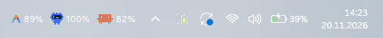

<div align="center">

# Claude Limit Tray

**Your remaining Claude Code usage limit right on the Windows taskbar — just like the battery percentage.**

<p>
  
  <br />
  <sub>On the Windows 11 taskbar, right next to the system tray and battery icon.</sub>
</p>

<p>
  
  <br />
  <sub>All 4 states at actual taskbar size (rendered directly by the app).</sub>
</p>

<p>
  
  
  
</p>

</div>

---

A tiny, single-file Windows taskbar widget that displays a pixel-art Claude mascot and your remaining usage percentage next to the system tray — no Electron, no background bloat, just one Python script.

## Features

- **Battery-style taskbar indicator** — crisp pixel-art mascot + remaining percentage rendered with `Segoe UI Variable` (plain `Segoe UI` on Windows 10), sized like the battery icon (tested at 100% display scaling; other scales are approximated).
- **5-hour & 7-day limits** — switch which window is shown on the taskbar via the right-click menu; hover to see **both limits** and exact reset countdowns.
- **At-a-glance color coding** — Claude orange (`≥ 30%`) → yellow (`< 30%`) → red (`< 10%`); gray with `?` when there is no data (offline or sign-in expired: open Claude Code to refresh it).
- **Stays out of your way** — automatically hides during fullscreen games/videos, when an auto-hidden taskbar collapses, or when the taskbar isn't at the bottom of the primary monitor.
- **Start with Windows** — optional one-click Startup shortcut in the context menu, plus single-instance protection so you never launch duplicates.

## Controls

| Action | Behavior |
| :--- | :--- |
| **Hover** | Show both 5-hour and 7-day remaining limits with reset times |
| **Left-click** | Refresh usage immediately |
| **Right-click** | Switch limit (**5 hours** / **Week**), **Refresh now**, toggle **Start with Windows**, or **Quit** |

## Requirements

- **Windows 10 or 11** (bottom taskbar on primary monitor)
- **Python 3.10+**
- **[Claude Code](https://claude.com/claude-code)** installed and signed in (Pro or Max plan)

## Quick Start

```powershell
git clone https://github.com/jakmot12/claude-limit-tray.git
cd claude-limit-tray
python -m pip install -r requirements.txt
pythonw claude_limit_tray.py
```

## Privacy & Security

- **Read-only credentials** — reads your existing Claude Code OAuth token from `%USERPROFILE%\.claude\.credentials.json`. It never writes, logs, or refreshes the token.
- **Direct HTTPS only** — sends the token exclusively to `https://api.anthropic.com/api/oauth/usage` with certificate verification and an honest `User-Agent` (`claude-limit-tray`). Zero third-party servers, zero telemetry.
- **Does not consume usage** — polling only reads your quota counter; it does not send prompts or invoke any model.
- **Local-only color sampling** — periodically samples a tiny 2 px strip of your taskbar in memory to blend font edges cleanly with your wallpaper. Nothing is ever saved or transmitted.
- **Minimal footprint** — stores only `%APPDATA%\ClaudeLimitTray\settings.json` (selected limit) and, if enabled, a Startup shortcut. The entire app is a single readable file: [`claude_limit_tray.py`](claude_limit_tray.py).

> [!WARNING]
> **Never share your `.credentials.json` file with anyone** — it grants full access to your Claude account.

> [!NOTE]
> This is an unofficial tool not affiliated with Anthropic. It uses the same undocumented OAuth usage endpoint as Claude Code's `/usage` command, which may change without notice.

## License

[MIT](LICENSE)
